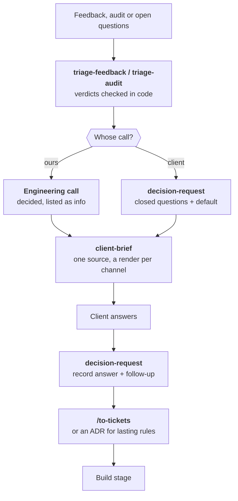

Agents write code fast. Two things don't speed up with them: the engineer's understanding of what was built, and the client's understanding of what we're telling them. These skills keep both from falling behind.

## The two gaps

**Comprehension debt.** An agent can fix a point, and an engineer can forward its summary, without either one knowing *why* the code behaves as it does. Worse, product choices get made silently in code — an agent picks a behaviour no one asked the client about. Months later nobody can say whether it was a bug, a shortcut or a decision.

**The language gap.** Clients think in screens, roles and workflows; we think in files, endpoints and commits. A technical answer reads as an excuse, and an open "let's discuss" item stalls for weeks.

## How we close them

- **Every point is checked in the code before it leaves.** Verdicts go stale; each one is re-checked at the current commit, with evidence an engineer can re-run.
- **Decisions belong to the client; engineering calls belong to us.** We decide what code and conventions can settle, and say so. Only real product choices go to the client.
- **Closed questions with a default.** Each decision arrives as options with what users get, effort and who acts — answerable with a letter. If no answer comes by the date, the default applies, so work never waits.
- **Product terms, not code terms.** Points name the on-screen text, the route and the role who sees it, read from the actual components. File paths and hashes stay in our log.
- **A decision log is the project's memory.** Every question, answer and follow-up lands in `DECISIONS.md` or the tracker, with research references. That is the answer to "why does it work like this?".

## The flow



| Situation | Skill |
| --- | --- |
| Client comment, QA ticket, review finding — is it true? | [`triage-feedback`](./skills/triage/triage-feedback.md) / [`triage-audit`](./skills/triage/triage-audit.md) |
| Findings or a plan contain "ask the client" / "needs discussion" | [`decision-request`](./skills/client/decision-request.md) |
| A report or verdict list has to go to a client, PM or other non-engineer | [`client-brief`](./skills/client/client-brief.md) |
| The client answered | [`decision-request`](./skills/client/decision-request.md) — record and create the follow-up |
| "Does the UI match Figma?" — for the designer | [`figma-qa`](./skills/design-qa/figma-qa.md) |

## The engineer stays the author

The skills draft; the engineer sends. Before a brief leaves:

1. **Read the research, not just the message.** Each point carries `file:line`, a command or a commit. If you can't explain a point from its evidence, you don't understand it yet — open the code.
2. **Check the product face.** Click the path the brief tells the client to follow. If it doesn't show what the brief claims, the verdict is wrong.
3. **Own the defaults.** A default is what we'll ship if the client stays silent; make sure you'd stand behind it.

That review is the point: by the time the client reads the message, the engineer can answer any follow-up question without asking the agent.

## Install

```bash
npx skills@latest add Phenomenon-Studio/phenomenon-skills --skill triage-feedback triage-audit decision-request client-brief
```
