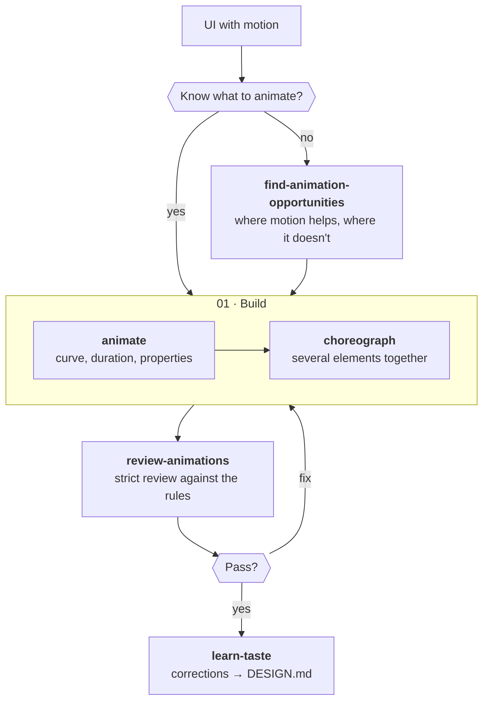

Our design layer is [Emil Kowalski's skills](https://github.com/emilkowalski/skills) (MIT). Like the [workflow](./workflow.md) skills, we link to them rather than copy them, so fixes upstream reach us automatically. Each skill has a page with examples and prompts at [aiforui.dev/skills](https://aiforui.dev/skills).

## Why

Agents don't have great taste. Left alone they pick `ease-in` for an enter animation, a solid border where a soft shadow belongs, a fade-in on every section. Each mistake is small; together they make the UI feel generic. These skills list those mistakes and how to fix them — background in [Agents with Taste](https://emilkowal.ski/ui/agents-with-taste).

## Install

Every project with a UI gets the main skill — design and animation fundamentals the agent applies while building:

```bash
npx skills@latest add emilkowalski/skills --skill emil-design-eng
```

The project has animations, transitions, gestures or other motion? Install the full set instead:

```bash
npx skills@latest add emilkowalski/skills
```

> Both Emil's and [Matt Pocock's](./workflow.md) collections ship a skill named `prototype`. Installing both sets in full gives the agent two skills with one name — pick one, or install Emil's skills by name with `--skill`.

## Motion lifecycle

Animation work follows the same plan → build → review loop as any feature. These skills slot in where motion is involved:



| Stage | Skill | Output |
| --- | --- | --- |
| Always on | [`emil-design-eng`](https://aiforui.dev/skills/emil-design-eng) | Design and animation defaults applied while building |
| Find | [`find-animation-opportunities`](https://aiforui.dev/skills/find-animation-opportunities) | Where motion helps, and what not to animate |
| Build | [`animate`](https://aiforui.dev/skills/animate) | An animation with the right curve, duration and properties |
| Coordinate | [`choreograph`](https://aiforui.dev/skills/choreograph) | Order and timing for elements that move together |
| Review | [`review-animations`](https://aiforui.dev/skills/review-animations) | Strict review of the animations in the change |
| Learn | [`learn-taste`](https://aiforui.dev/skills/learn-taste) | The session's design corrections as rules in `DESIGN.md` |

Run `review-animations` next to [`code-review`](./workflow.md#feature-lifecycle) whenever the change touches motion — `code-review` doesn't judge easing or timing.

## Existing codebase

| Situation | Skill |
| --- | --- |
| Audit every animation, get prioritized fix plans | [`improve-animations`](https://aiforui.dev/skills/improve-animations) |
| Too much motion: keyboard shortcuts, every section fading in | [`remove-animations`](https://aiforui.dev/skills/remove-animations) |
| Animations drop frames | [`animation-performance`](https://aiforui.dev/skills/animation-performance) |

## Other useful skills

- [`ask-emil`](https://aiforui.dev/skills/ask-emil) — not sure which skill fits? Describe the situation and it points to one, or a sequence.
- [`animation-vocabulary`](https://aiforui.dev/skills/animation-vocabulary) — the words that get the animation you mean.
- [`gestures`](https://aiforui.dev/skills/gestures) — drag, swipe and sheets that track the finger and keep release velocity.
- [`animate-expo`](https://aiforui.dev/skills/animate-expo) — `animate` for React Native and Expo.
- [`mobile-native`](https://aiforui.dev/skills/mobile-native) — make a web app feel native on phones: tap highlights, `100vh`, input zoom, safe areas.
- [`break-ui`](https://aiforui.dev/skills/break-ui) — stress the UI with worst-case data: long names, huge counts, empty lists.
- [`pick-ui-library`](https://aiforui.dev/skills/pick-ui-library) — pick a maintained library instead of hand-rolling a toast or dialog.
- [`apple-design`](https://aiforui.dev/skills/apple-design) — Apple's interface and motion principles, translated for the web.

Full list: [emilkowalski/skills](https://github.com/emilkowalski/skills).

## Checking against Figma

Taste is half of it; the other half is matching the design you were given. Our [`figma-qa`](./skills/design-qa/figma-qa.md) skill pairs each Figma node with its story or route, measures computed styles against the spec values, and reports every diff with the file that owns it — see [Design QA](./skills/design-qa/index.md).
