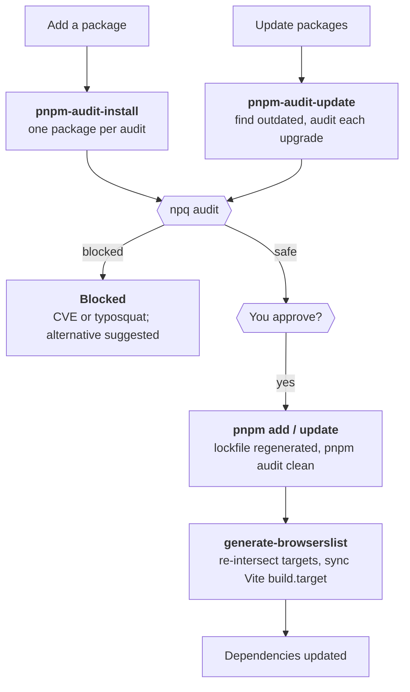

Skills that guard what enters `node_modules` and keep build targets consistent with it.

- `pnpm-audit-install` and `pnpm-audit-update` run every package through [npq](https://github.com/lirantal/npq) before it is installed. Recommended for **every** JS/TS project.
- `generate-browserslist` is for Vite projects: it intersects every dependency's browser support and syncs Vite's `build.target`.

**Role in the lifecycle:** a gate on every change to `package.json`, whichever stage it happens in. Nothing reaches `node_modules` without an audit and your approval.



<!-- skills:start -->
## Skills

- [`generate-browserslist`](./generate-browserslist.md) — Generate a project-wide browserslist configuration that is compatible with every declared dependency's own browserslist settings by intersecting the supported browser sets, then sync the result to Vite's build.target. Use when the user wants to create, update, or audit the `browserslist` field / `.browserslistrc`, keep Vite's `build.target` in lockstep with it, ensure dependency compatibility, or debug "unsupported target" build warnings.
- [`pnpm-audit-install`](./pnpm-audit-install.md) — Audit packages with npq before adding them with pnpm. Use when the user wants to add a dependency, or check whether a package is safe without installing it.
- [`pnpm-audit-update`](./pnpm-audit-update.md) — Find outdated dependencies, audit each upgrade with npq, and apply approved ones with pnpm. Use when the user wants to update dependencies, check for outdated packages, or upgrade versions safely.

Install the whole group:

```bash
npx skills@latest add Phenomenon-Studio/phenomenon-skills --skill generate-browserslist pnpm-audit-install pnpm-audit-update
```
<!-- skills:end -->
