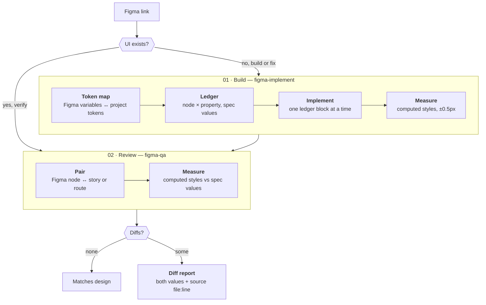

For projects with Figma designs. Both skills need a Figma MCP server and browser automation to measure the rendered page.

- Building or fixing UI from a Figma link → `figma-implement`.
- Checking UI that already exists against Figma → `figma-qa`. Storybook makes the run far more reliable — `figma-qa` lists the setup it expects.

**Role in the lifecycle:** `figma-implement` is the **Build** stage for Figma-driven UI: it turns every visible node into a ledger of spec values, maps each to the project's tokens, and closes a value only when the browser measures it. `figma-qa` sits in **Review**, next to `code-review`: code review checks the code against standards and spec; design QA checks the rendered UI against Figma. It reports diffs by default and fixes them only when asked, so the report can go to the designer as-is.



<!-- skills:start -->
## Skills

- [`figma-implement`](./figma-implement.md) — Implement or fix UI to exact Figma spec values through a node-by-node ledger, measured in the browser before done, with the designer's annotations checked against the project. Use when the user shares a figma.com link to build, implement, port, or fix a screen, section, or component layout.
- [`figma-qa`](./figma-qa.md) — Visual QA of implemented React UI against its Figma design — pairs each Figma node with a rendered story or route, measures computed styles against spec values, and reports every diff with evidence. Use when the user asks whether UI matches Figma, wants design QA / a pixel check / a visual diff, or hands over Figma links to verify an implementation, in a project without the storybook-figma-qa kit.

Install the whole group:

```bash
npx skills@latest add Phenomenon-Studio/phenomenon-skills --skill figma-implement figma-qa
```
<!-- skills:end -->
