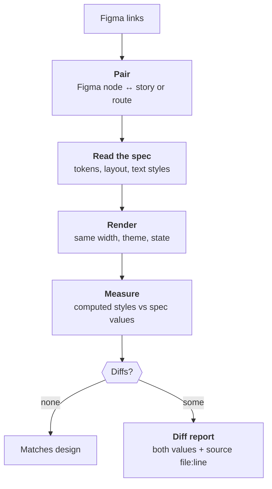

For projects with Figma designs. Needs a Figma MCP server (or REST token) and browser automation; Storybook makes the run far more reliable — `figma-qa` lists the setup it expects.

**Role in the lifecycle:** **Review**, next to `code-review`. Code review checks the code against standards and spec; design QA checks the rendered UI against Figma. It reports diffs by default and fixes them only when asked, so the report can go to the designer as-is.



<!-- skills:start -->
## Skills

- [`figma-qa`](./figma-qa.md) — Visual QA of implemented React UI against its Figma design — pairs each Figma node with a rendered story or route, measures computed styles against spec values, and reports every diff with evidence. Use when the user asks whether UI matches Figma, wants design QA / a pixel check / a visual diff, or hands over Figma links to verify an implementation.

Install the whole group:

```bash
npx skills@latest add Phenomenon-Studio/phenomenon-skills --skill figma-qa
```
<!-- skills:end -->
