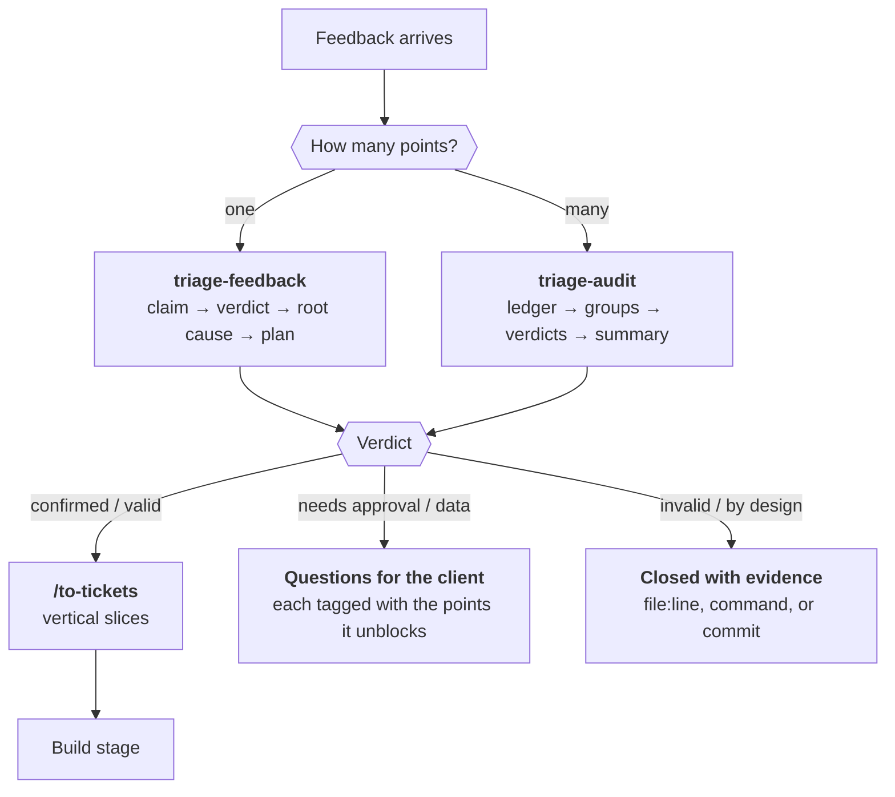

Entry point for incoming feedback. Each point gets checked against the codebase and a verdict (valid, invalid, needs approval, needs data) with root cause and fix plan.

- One point (a client comment, a QA ticket, another agent's review finding) → `triage-feedback`.
- A document with many points (audit, QA report) → `triage-audit`.

**Role in the lifecycle:** the second entry point, next to a new idea. Triage replaces the planning stage for work that arrives as feedback: a confirmed point already has its claim, root cause and fix plan, so it goes straight to `/to-tickets` and continues from **Build** in the [workflow](../../workflow.md).



Every verdict cites evidence a reader can re-check — `file:line`, a command with its output, or a commit — so the client gets an answer either way.

<!-- skills:start -->
## Skills

- [`triage-audit`](./triage-audit.md) — Triage an audit — a document listing many feedback points from a client, QA, or an auditor agent — into a summary report plus per-point verdicts checked against the codebase. Use when the user points at an audit, review, or QA report with multiple items. For one point, use triage-feedback.
- [`triage-feedback`](./triage-feedback.md) — Triage a short piece of feedback into an engineer-ready report — claim, verdict, root cause, fix options, plan, guardrail. Use when the user pastes or points at client feedback, a QA ticket, or another agent's review finding.

Install the whole group:

```bash
npx skills@latest add Phenomenon-Studio/phenomenon-skills --skill triage-audit triage-feedback
```
<!-- skills:end -->
