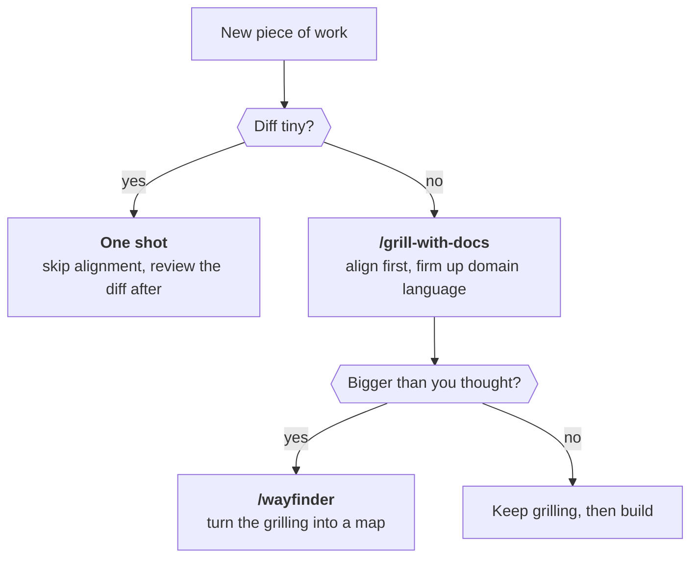
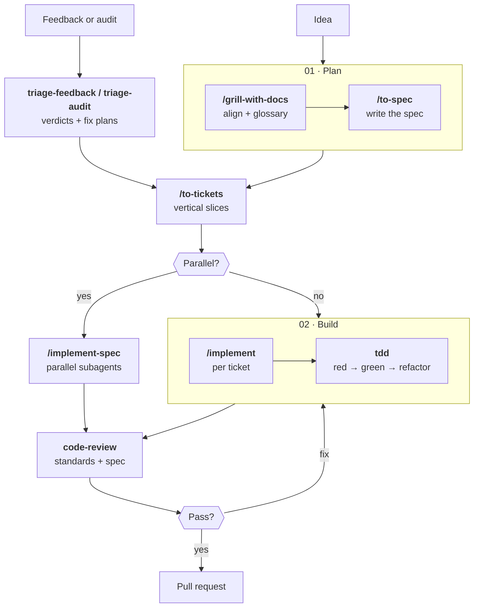

Our workflow layer is [Matt Pocock's skills](https://github.com/mattpocock/skills) (MIT). We link to them rather than copy them, so fixes upstream reach us automatically. Install them in [Getting started → Base](./getting-started.md#11-matt-pococks-skills).

## Philosophy

The skills are deliberately **small and composable**. They don't take over your process the way all-in-one frameworks do — you stay in control and can see where things go wrong. Each one targets a specific way agent work fails:

| Failure mode | Fix | Skills |
| --- | --- | --- |
| Agent builds the wrong thing | Get aligned **before** work starts: a relentless interview about the plan | `grill-me`, `grill-with-docs` |
| Agent is verbose, uses its own jargon | A shared ubiquitous language in `GLOSSARY.md`, plus ADRs for hard decisions | `domain-modeling`, `wait-what` |
| Code doesn't work | Feedback loops — types, tests, browser — in small, deliberate steps | `tdd`, `diagnosing-bugs` |
| Codebase turns into a ball of mud | Care about design: deep modules, clear seams | `codebase-design`, `improve-codebase-architecture` |

Skills come in two kinds:

- **User-invoked** — orchestrators you type (`/to-spec`, `/implement`).
- **Model-invoked** — disciplines the agent picks up on its own (`tdd`, `code-review`).

A user-invoked skill may call model-invoked ones, never another user-invoked one.

## Starting a session

New piece of work and not sure which skill to reach for? Size the risk first.

- **Tiny diff** — you can review it quickly and retrying costs almost nothing. Let the agent go, then align on the result.
- **Not tiny** — run [`grill-with-docs`](https://github.com/mattpocock/skills/tree/main/skills/engineering/grill-with-docs) before building.
- **Bigger than expected** — the grilling drifts or the fog keeps growing: switch to [`wayfinder`](https://github.com/mattpocock/skills/tree/main/skills/engineering/wayfinder) and work from its map.

## Feature lifecycle

| Stage | Skill | Output |
| --- | --- | --- |
| Align | [`grill-with-docs`](https://github.com/mattpocock/skills/tree/main/skills/engineering/grill-with-docs) | Resolved decisions, updated `GLOSSARY.md` / ADRs |
| Specify | [`to-spec`](https://github.com/mattpocock/skills/tree/main/skills/engineering/to-spec) | Spec in your issue tracker |
| Break down | [`to-tickets`](https://github.com/mattpocock/skills/tree/main/skills/engineering/to-tickets) | Tracer-bullet tickets with blocking edges |
| Build | [`implement`](https://github.com/mattpocock/skills/tree/main/skills/engineering/implement) | Code, built test-first with [`tdd`](https://github.com/mattpocock/skills/tree/main/skills/engineering/tdd) |
| Review | [`code-review`](https://github.com/mattpocock/skills/tree/main/skills/engineering/code-review) | Standards + spec review |
| Ship | [`pr`](https://github.com/mattpocock/skills/tree/main/skills/engineering/pr) | PR body with evidence |

Feedback or audit coming in? Start with our [`triage-feedback`](./skills/triage/triage-feedback.md) / [`triage-audit`](./skills/triage/triage-audit.md) → verdicts with fix plans → `/to-tickets` → continue from **Build**.

Large or parallel work: [`implement-spec`](https://github.com/mattpocock/skills/tree/main/skills/engineering/implement-spec) (parallel subagents on one branch) and [`wayfinder`](https://github.com/mattpocock/skills/tree/main/skills/engineering/wayfinder) (map of decision tickets).

Run `tsc` and lint after every change — the cheapest feedback loop there is.

## Other useful skills

- [`diagnosing-bugs`](https://github.com/mattpocock/skills/tree/main/skills/engineering/diagnosing-bugs) — gated loop for hard bugs and perf regressions.
- [`prototype`](https://github.com/mattpocock/skills/tree/main/skills/engineering/prototype) — throwaway prototype to answer a design question.
- [`improve-codebase-architecture`](https://github.com/mattpocock/skills/tree/main/skills/engineering/improve-codebase-architecture) — run every few days to find deepening opportunities.
- [`handoff`](https://github.com/mattpocock/skills/tree/main/skills/productivity/handoff) — compact a conversation into a doc for a fresh agent.
- [`writing-for-agents`](https://github.com/mattpocock/skills/tree/main/skills/productivity/writing-for-agents) — writing skills and `CLAUDE.md` / `AGENTS.md`.
- [`ask-matt`](https://github.com/mattpocock/skills/tree/main/skills/engineering/ask-matt) — not sure which skill fits? Ask this one.

Full list: [mattpocock/skills](https://github.com/mattpocock/skills).

## Context management

| Practice | Why |
| --- | --- |
| Start each stage in a fresh conversation | Earlier stages' context doesn't pollute later decisions |
| Reference specs by path or ticket, don't paste | The agent reads only what it needs |
| Grill in its own conversation | Interviews are long; keep them out of implementation context |
| Let skills carry library knowledge | Don't paste TanStack docs — the skills already encode our patterns |
| One concern per conversation | Don't mix a bug fix with a feature |
| Validate early, validate often | `tsc` + lint after each change catches issues before they compound |
